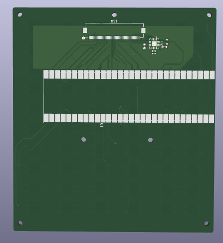
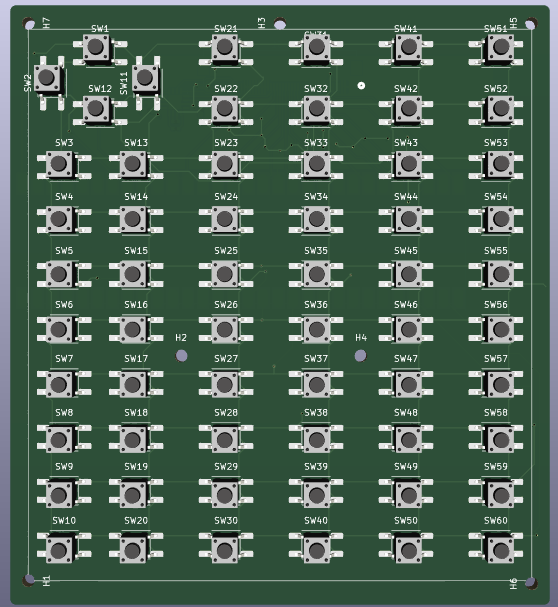
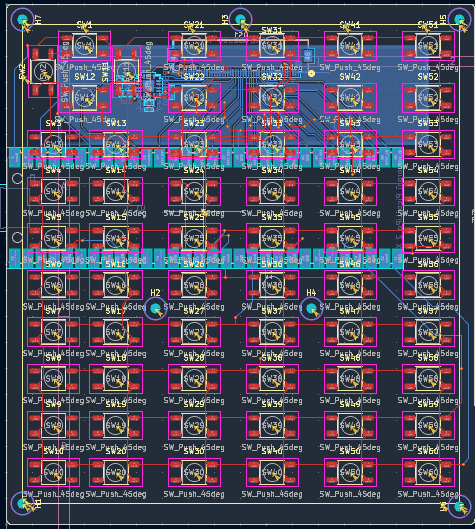
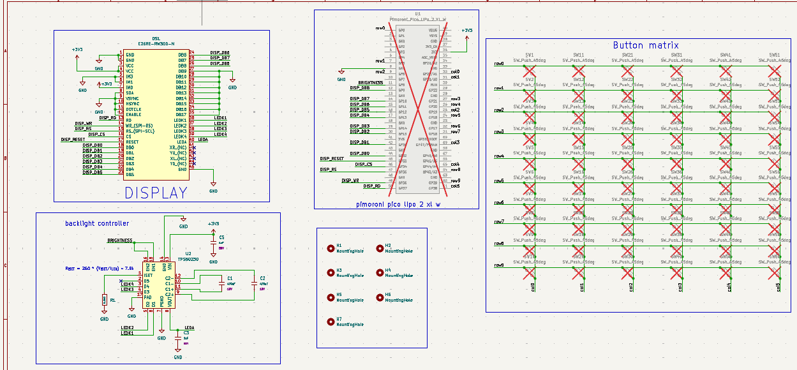

# pico-calc2

A calculator pcb for a Pi-hat like attachment for the Pimoroni Pico LiPo 2 XL W

Could also be used for other pico projects

### Assembly:

solder frames to back of board as necessary (to elevate pico 2 xl above pcb)

solder pico lipo 2 xl onto frame

solder buttons to board (test to make sure all buttons are placed)

insert ribbon connector into ribbon receptacle

insert battery into receptacle

### Images:
#### pcb

#### layers

#### schematic

#### frame
one side of the frame; used to elevate the pico above the board

BOM:

|component|webpage|notes|
|-|-|-|
|1 x pimoroni pico lipo 2 xl w|[https://shop.pimoroni.com/en-us/products/pimoroni-pico-lipo-2-xl-w?variant=55447911006587 ](https://shop.pimoroni.com/en-us/products/pimoroni-pico-lipo-2-xl-w?variant=55447911006587)||
|60 x (4.5mm x 4.5mm x 3.8mm) buttons|[https://www.amazon.com/100Pcs-Tactile-Actuator-Surface-Momentary/dp/B07CJSV1ZW?psc=1](https://www.amazon.com/100Pcs-Tactile-Actuator-Surface-Momentary/dp/B07CJSV1ZW?psc=1)|any buttons with those dimensions work|
|any lipo battery (tbd)|[https://shop.pimoroni.com/en-us/products/pimoroni-pico-lipo?q=lipo](https://shop.pimoroni.com/en-us/products/pimoroni-pico-lipo?q=lipo)|tbd what battery to use|
|1 x E26RE-RW300-N|[https://www.digikey.com/en/products/detail/focus-lcds/E26RE-RW300-N/20117034](https://www.digikey.com/en/products/detail/focus-lcds/E26RE-RW300-N/20117034)||

